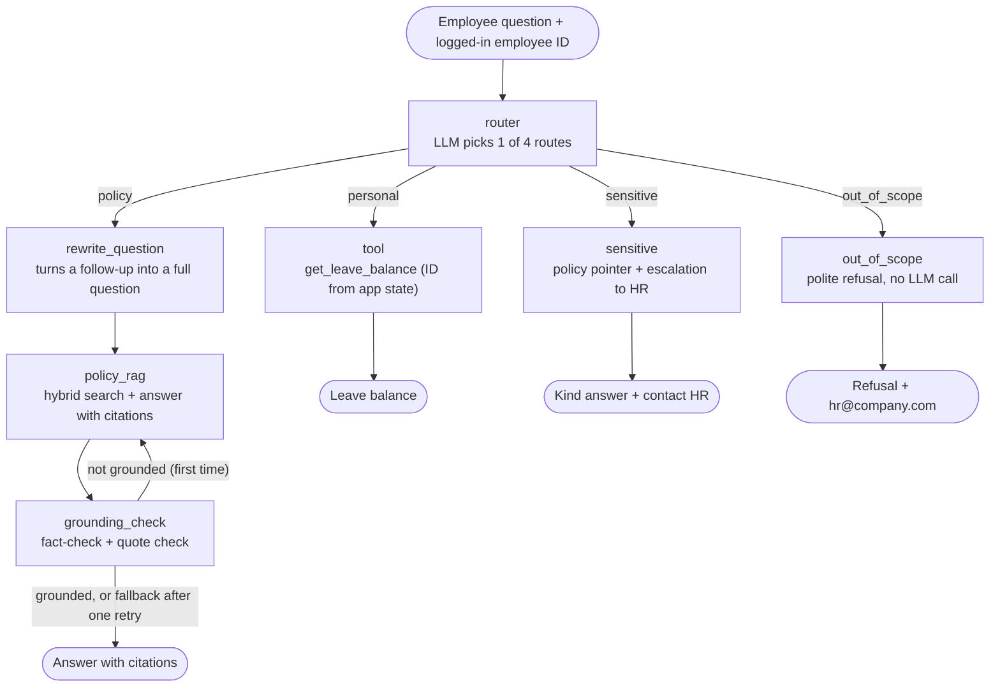

# HR Policy Copilot

A chat assistant that answers employee questions about company HR policies **only from the official policy documents**.
Every policy answer shows **citations** (document, section and a short quote), the assistant **refuses or sends the person to HR** when the answer is not in the documents, and it looks up personal data (leave balance) with a **tool**, never by guessing.

Built with LangChain, LangGraph, Chroma, Streamlit and LangSmith. Everything runs on free tiers, so the real cost is **Rs 0**.

## What it does

| Question type | What the copilot does |
|---|---|
| Policy ("How many casual leaves do I get?") | Hybrid search (BM25 + vector), an answer with citations, then a fact-check of the answer |
| Personal ("What is my leave balance?") | Calls the `get_leave_balance` tool for the logged-in employee. The employee ID comes from the app, never from the typed text |
| Sensitive (harassment, grievance, medical) | A kind answer that points to the right policy section and the right contact. Always tells the person to contact HR |
| Out of scope / not in the documents | A polite refusal and `hr@company.com`. It never invents a policy |
| Follow-up ("and for interns?") | Rewrites the follow-up into a full question using the chat history, then answers as a policy question |

Guardrails: answers use only the retrieved text, quotes are checked word for word against the retrieved chunks, one stricter retry, then a safe fallback message. Employee IDs are masked in logs (`E1001` becomes `E1***`).

## Architecture



The same graph is drawn automatically into `docs/architecture.md` by `python -m src.graph`.
Chat memory is kept per `thread_id` with LangGraph's `MemorySaver`. A new chat in the app gets a new `thread_id`.

### Folders

```
data/policies/        6 HR policies (5 Markdown files and 1 PDF)
data/hrms_mock.json   mock leave balances for the tool
src/                  config, ingest, retriever, rag_chain, graph, tools, schemas, logging helpers
app/                  streamlit_app.py (the chat UI)
eval/                 golden_qa.json (40 questions), run_eval.py, report.md, failure_analysis.md
tests/                85 unit tests (most need no key or internet)
docs/                 architecture.md, LEARNINGS.md
```

## Setup

These steps are for **Windows with VS Code (PowerShell)**. They were tested on Python 3.13.5. Mac/Linux commands are at the end of this section.

1. Open the project folder in VS Code and open a terminal (PowerShell).
2. Create and activate a virtual environment:
   ```powershell
   python -m venv .venv
   .venv\Scripts\Activate.ps1
   ```
   If PowerShell says scripts are disabled, run `Set-ExecutionPolicy -Scope Process -ExecutionPolicy Bypass` first and activate again. You should see `(.venv)` at the start of the line.
3. Install the packages:
   ```powershell
   pip install -r requirements.txt
   ```
4. Create your `.env` file from the example and fill in your keys:
   ```powershell
   Copy-Item .env.example .env
   ```
   You need a **free Groq key** (console.groq.com) for the default setup. The `.env` file is ignored by Git. Never put a key in the code.
5. Check that everything is ready (it never prints your keys):
   ```powershell
   python check_setup.py
   ```
   You want `[OK]` on every line.

<details>
<summary>Mac or Linux</summary>

```bash
python3 -m venv .venv && source .venv/bin/activate
pip install -r requirements.txt
cp .env.example .env
python check_setup.py
```
</details>

### Free tools used

| Part | Tool | Cost |
|---|---|---|
| LLM | Groq free key (`openai/gpt-oss-20b`) | Rs 0 |
| Embeddings | HuggingFace `BAAI/bge-small-en-v1.5`, runs on your computer | Rs 0 |
| Vector store | Chroma, saved in `chroma_db/` | Rs 0 |
| Tracing | LangSmith free plan | Rs 0 |
| UI | Streamlit | Rs 0 |

## How to run

Run every command from the project root with the virtual environment active.

| Job | Command |
|---|---|
| **Ingest** the policies (safe to run again, it adds nothing twice) | `python -m src.ingest` |
| **Chat app** | `streamlit run app/streamlit_app.py` |
| Try the graph on demo questions and redraw the diagram | `python -m src.graph` |
| Try follow-up memory (3 chats) | `python demo_memory.py` |
| Compare vector, BM25 and hybrid search | `python -m src.retriever` |
| **Evaluation** (hybrid search) | `python eval/run_eval.py --retriever hybrid` |
| Evaluation (vector only, for the comparison) | `python eval/run_eval.py --retriever vector` |
| **Tests** | `pytest` |
| Tests without the ones that call the real LLM | `pytest -m "not llm"` |

**The app:** pick a user in the sidebar (the IDs come from `data/hrms_mock.json`), ask a question, and open **Sources** under an answer to see the document, section and quote. The sidebar shows the active model, and every answer has thumbs up/down (saved in `feedback.jsonl`). **New chat** starts a fresh memory.

**The evaluation:**
- It runs the 40 questions in `eval/golden_qa.json` through the copilot and scores them with an LLM judge (correctness, faithfulness, refusal accuracy), plus retrieval hit-rate@5, citation presence, latency, tokens and an **estimated** cost.
- Results are saved after every question in `eval/results_<retriever>.json`. If it stops (for example on a free-tier rate limit), run the same command again and it resumes. Use `--fresh` to start over and `--limit 3` for a quick trial.
- It writes `eval/report.md` with the metrics, the vector-vs-hybrid table and every failed question.

**Logs:** each query adds one line of numbers (route, seconds per step, tokens, estimated cost) to `logs/queries.jsonl`. The question text is not stored and employee IDs are masked. The `logs/` folder is ignored by Git.

## How to switch the LLM provider

The model is chosen **only by the `.env` file**. No Python file has to change. The embedding model stays local, so you do **not** need to run ingest again.

**Groq (default for this project)**
```env
LLM_PROVIDER=groq
LLM_MODEL=openai/gpt-oss-20b
GROQ_API_KEY=your-groq-key
```

**Google Gemini (free tier)**
```env
LLM_PROVIDER=google_genai
LLM_MODEL=gemini-flash-latest
GOOGLE_API_KEY=your-google-key
```

Steps:
1. Edit `.env` (it is ignored by Git, so your keys stay private).
2. Optional check: `python check_setup.py`
3. Stop the app and start it again: `streamlit run app/streamlit_app.py`. The app reads `.env` only at start.
4. The sidebar shows the active model, for example `LLM: groq / openai/gpt-oss-20b`.

Proof that no code changes: after the switch, `git diff --stat -- "*.py"` prints nothing.
Other LangChain providers (`openai`, `ollama`, ...) work the same way with their own key and model name.

> **Status of this check:** Groq is tested end to end. Gemini: TODO (fill in after the provider-switch test: the model name used and the date).
> Model names get retired by providers (a Gemini 2.5 name returned "no longer available" during this project), so check the current free model name in Google AI Studio and put it in `.env`.

## Results

First full evaluation run (40 questions: 30 answerable, 10 that must be refused). The judge is an LLM, so scores can move by a question or two between runs (one question is about 3 points). Estimated cost is **not** a real bill: it is the token count times a guessed price, and the real cost was Rs 0.

| Metric | Target | Hybrid | Vector only |
|---|---|---|---|
| Answer correctness | 80% or more | 83.3% (25/30) | 80.0% (24/30) |
| Refusal accuracy | 90% or more | 100% (10/10) | 90.0% (9/10) |
| Faithfulness | - | 100% (26/26) | 96.2% (25/26) |
| Retrieval hit-rate@5 | - | 100% (26/26) | 100% (26/26) |
| Citation presence | - | 96.2% (25/26) | 100% (26/26) |
| Average latency | under 8 s | 12.61 s | 9.91 s |
| p95 latency | - | 22.70 s | 18.00 s |
| Tokens per question | - | 2,769 | 2,691 |
| Estimated cost per question | - | $0.00031 | $0.00029 |

- Correctness and refusal targets are met. The latency target is **not** met (see `docs/LEARNINGS.md`).
- After the first run I made small prompt changes. Results after the change: **TODO** (fill in from `eval/report.md` once the re-run is complete).
- The full list of failed questions and the analysis of 5 failure cases are in `eval/report.md` and `eval/failure_analysis.md`.

## Known limits

- A question that needs both personal data and a policy rule ("Can I take 5 days of PL?" as a probation employee) goes to the tool route and only gets the balances.
- The sensitive route is not fact-checked by the grounding step; its prompt only allows pointing to policy text.
- Free tiers have limits. Groq's free plan allowed 200,000 tokens per day for this model, and one full evaluation uses about that much. Slow answers in the evaluation (50 to 115 s) are probably free-tier waiting, but I could not prove that.
- The employee dropdown is not real login. LangSmith traces still contain the real employee ID (only our own logs mask it).

## Troubleshooting

| What you see | What to do |
|---|---|
| `429 ... tokens per day (TPD)` from Groq | The free daily budget is used up. Wait (the window rolls over 24 hours). Evaluation runs resume where they stopped. |
| `model ... not found` (404) | The model name was retired. Pick a current one and change only `LLM_MODEL` in `.env`. |
| First question after starting is slow | The embedding model is loading. The app loads it once at start. |
| Streamlit prints many `torchvision` or `transformers` messages | Harmless. Create `.streamlit/config.toml` with `[server]` and `fileWatcherType = "none"`. |
| `python check_setup.py` shows `[FAIL]` | Read the message next to it. It says which key or package is missing. |