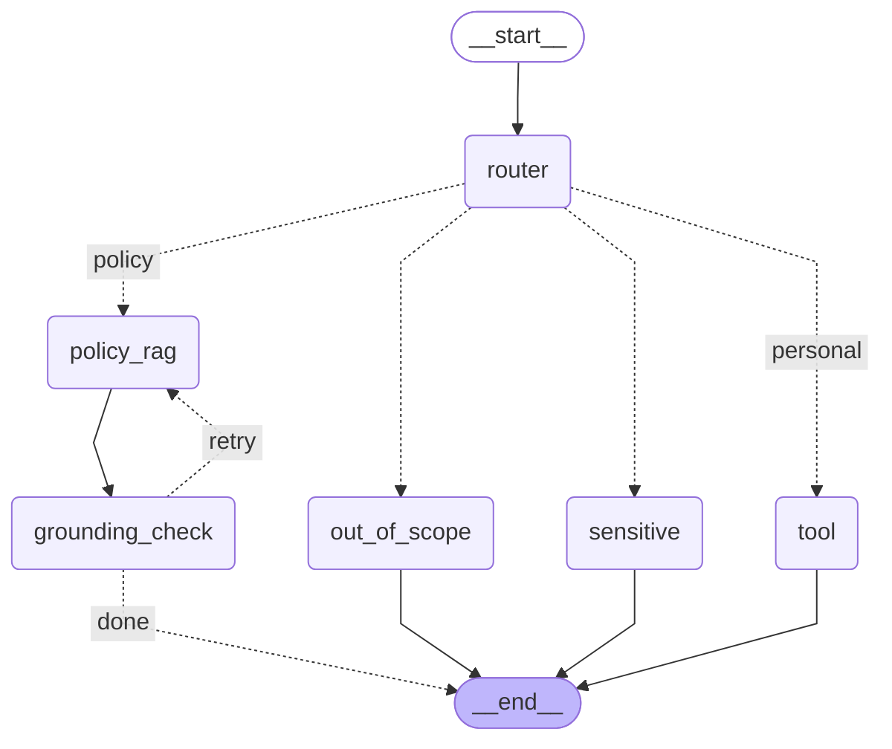

# Architecture

Drawn automatically by `python -m src.graph` (do not edit by hand).

| Node | Job |
|---|---|
| router | Reads the question and picks one of 4 routes |
| policy_rag | Finds policy chunks (hybrid search) and writes a cited answer |
| grounding_check | Second LLM call that fact-checks the answer; retries once, then falls back |
| tool | Looks up the employee's leave balance in the HRMS (ID from state) |
| sensitive | Kind reply that points to the right policy and contact |
| out_of_scope | Polite refusal |
